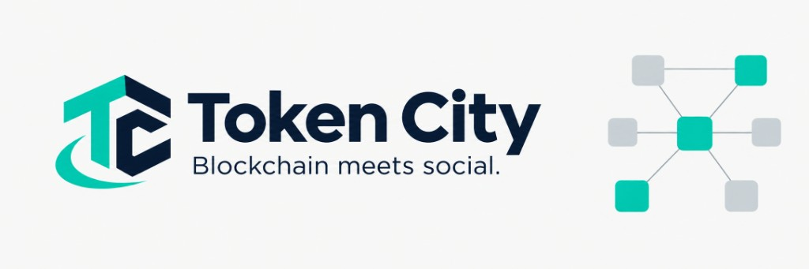

  

  Global social platform for blockchain and cryptocurrency. 
  Connection, discovery, and hands-on learning in one place.

Token City increases worldwide interest, understanding, and participation in blockchain technology and cryptocurrency. It brings social profiles, global communities, creator content, messaging, events, and interactive learning into one platform.

Members discover how blockchain works, discuss real-world uses, connect with people and projects, and build confidence through shared experiences. AI-assisted discovery, multilingual explanations, and practical Web3 demonstrations support that experience.

| Discover | Connect | Learn |
| --- | --- | --- |
| Blockchain applications, emerging ideas, and ways to contribute | Newcomers, enthusiasts, creators, developers, and projects | Concepts through social content, discussion, and practice |

## Outcomes

- Greater worldwide awareness and understanding of blockchain technology and cryptocurrency
- Accessible learning through social content, discussions, and practical experiences
- Meaningful connections between newcomers, enthusiasts, creators, developers, and projects
- Discovery of blockchain applications, emerging ideas, and opportunities to contribute
- Member-controlled identity, private communication, and safe community participation
- Recognition for verified learning, useful contributions, and community collaboration

## Who participates

The member stays at the center, from a first-time learner to an experienced blockchain developer. Members choose which interests, creations, learning achievements, and activities to share.

Creators and educators publish explanations, demonstrations, and discussions. Developers and project teams share technical knowledge and clearly identified project updates. Community managers handle membership, learning programs, moderation, messaging, and disputes. Sponsors fund activities and benefits without unrestricted access to member data. Event and partner organizations manage workshops, programs, staff, and delivery.

Social sharing does not include private messages, precise location, identity documents, or restricted account information. Every participant sees and does only what they are authorized to do.

## Token City Connect

Optional wearables, mobile devices, event check-in equipment, and dedicated hardware can support approved workshops and community activities. Core social participation does not require hardware. A device signal is supporting evidence and a request for review, not confirmed participation or a reward.

Location is limited to the event and used only as needed. Where density, consent, safety rules, and local law allow it, a member may receive a short invitation with an approximate location and can accept or decline. Participation is voluntary.

## Technology

| Area | Technology |
| --- | --- |
| Web | SvelteKit + TypeScript |
| Backend | Go |
| Operational data | PostgreSQL |
| Evidence and attachments | Controlled object storage |
| Identity | OIDC, RBAC, consent, staff MFA |
| Interoperability | Blockchain project, community, creator, and event partner APIs |
| IoT | nRF5 Series, STM32, Arduino BLE; BLE and Wi-Fi |
| AI | Backend-managed assistance for explanations, summaries, and discovery |
| Observability | OpenTelemetry |
| Rewards | Go reward service; Hyperledger Fabric and Go chaincode as a proposed ledger |
| Reward views | PostgreSQL projections of committed ledger events |

Social feeds, learning content, community communication, and member content stay available if the reward ledger is down.

Build in this order: identity and consent, social profiles and communities, accessible learning and content discovery, devices and integrations, participation validation, community programs, AI assistance, moderation, sponsor funding, then authorized reward accounting.

## Benefits and rewards

Optional programs recognize verified learning and community contributions. Communities, creators, and sponsors fund eligible programs. Members do not buy, deposit, invest, or trade reward units. The app shows a benefit balance. Credits are closed-loop: not sold to users, not transferred between members, not cash by default, and not listed on an exchange. Legal treatment is reviewed per market and sponsor before launch.

Hyperledger Fabric is proposed only as an internal ledger for authorized reward movements. Use it in production if multiple organizations need a shared, independently verifiable record and the audit benefit outweighs the operating cost. Until that exists, compare it with a conventional audited database.

AI explains concepts, summarizes permitted content, and recommends communities and learning activities. It does not change membership rights, override moderators, release funds, or authorize rewards.

## Privacy and safety

Encrypt data in transit and at rest. Use OIDC, server-side authorization, role-based access, staff MFA, and retention controls. Precise location is purpose-limited and expires with the event. Members can manage participation, content visibility, blocking, reporting, and location permission.

## Success

More people worldwide discovering blockchain technology and cryptocurrency, improving their understanding, joining constructive discussions, and returning to learn and contribute. Measure learning progress, member retention, useful content, active communities, verified contributions, and long-term trust.
